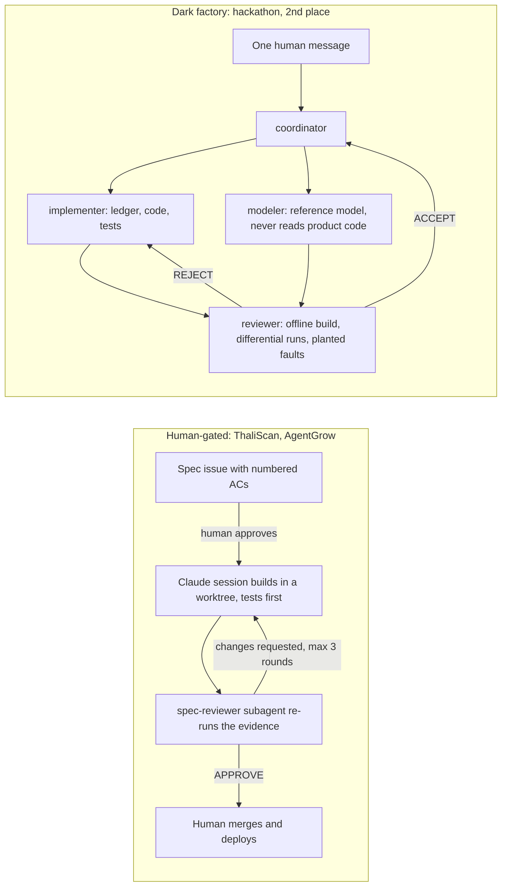

# Claude Code setup — real files from production and competition repos

> **🥈 2nd place, pocketful track, WeAreDevelopers × BAND "Dark Factory" hackathon (lablab.ai, October 2026). Prize: $1,000.**
> Four Claude Code seats built a payments service through all four stages from **one human message**:
> 8 h 46 min, **$74.88** at list price, **36 / 36** planted faults caught, and every stage passing the official
> harness from a fresh clone in an offline container. The seat mandates are in [`dark-factory/`](dark-factory/);
> the full run is in [pocketful-dark-factory-v2](https://github.com/ghewaredevopsai/pocketful-dark-factory-v2)
> ([video](https://youtu.be/Uoi_bmq9ttM), [LinkedIn write-up](https://www.linkedin.com/feed/update/urn:li:activity:7517120009123319808/)).

These are the Claude Code files I run every day, copied unedited from four of my repos plus my user-level config.
The product repos are private, so this repository publishes the files that configure Claude, not the product code.
The only changes: personal sections were removed from the user-level `CLAUDE.md`, and two long files are excerpts (marked).

Rajesh Gheware · [Gheware DevOps AI](https://github.com/ghewaredevopsai)

## Start here (five minutes)

1. [`dark-factory/mandates/reviewer.md`](dark-factory/mandates/reviewer.md): the seat that had to plant faults and catch them before it could accept anything. 36 planted, 36 caught.
2. [`thaliscan/.claude/agents/spec-reviewer.md`](thaliscan/.claude/agents/spec-reviewer.md): a review subagent that gets the PR number, not the author's summary, and re-runs the evidence itself.
3. [`kaggle-gemma4-agent/.claude/settings.json`](kaggle-gemma4-agent/.claude/settings.json): a PostToolUse hook that validates the agent after every edit, so a broken change never reaches an expensive GPU run.

## What is here

| Folder | Repo it comes from | What it shows |
|---|---|---|
| [`dark-factory/`](dark-factory/) | The hackathon submission ([public](https://github.com/ghewaredevopsai/pocketful-dark-factory-v2)), 2nd place | The four seat mandates: a [coordinator](dark-factory/mandates/coordinator.md) that never writes code, an [implementer](dark-factory/mandates/implementer.md), a [modeler](dark-factory/mandates/modeler.md) that models the spec without reading the product code, and a [reviewer](dark-factory/mandates/reviewer.md) that plants faults before it accepts anything |
| [`user-level/`](user-level/) | `~/.claude` on my machine | Behavioural rules for every project ([`CLAUDE.md`](user-level/CLAUDE.md)) and a skill I wrote, [`feature-engineering`](user-level/skills/feature-engineering/SKILL.md): plan → verify claims against the code → test-first build → review |
| [`agentgrow/`](agentgrow/) | AgentGrow ([agentgrow.io](https://agentgrow.io); repo name `hire-ai-business-agents`), FastAPI + Next.js + Postgres on Kubernetes, in production | Committed [permissions](agentgrow/.claude/settings.json) (shared allow-list; `.env` and build output denied), a [SessionStart hook](agentgrow/.claude/settings.json) that prints a [start-here note](agentgrow/.claude/session-start.md) and [prepares the test database](agentgrow/scripts/cloud-session-start.sh) in cloud sessions, the [`/spec` command](agentgrow/.claude/commands/spec.md), and the [working rules](agentgrow/CLAUDE-working-discipline.md) from its CLAUDE.md |
| [`thaliscan/`](thaliscan/) | ThaliScan ([thaliscan.glucoray.com](https://thaliscan.glucoray.com)), meal-photo carb estimates for diabetics, live | The AI first-pass PR review loop with human gates ([workflow](thaliscan/AGENTS-workflow.md)), the [`spec-reviewer`](thaliscan/.claude/agents/spec-reviewer.md) and [`invariant-reviewer`](thaliscan/.claude/agents/invariant-reviewer.md) subagents, an [eval-loop skill](thaliscan/.claude/skills/vision-eval/SKILL.md), a [real-browser e2e skill](thaliscan/.claude/skills/e2e/SKILL.md), and [permissions](thaliscan/.claude/settings.json) |
| [`kaggle-gemma4-agent/`](kaggle-gemma4-agent/) | My entry to Kaggle's Gemma 4 developer-agent competition | A [PostToolUse hook](kaggle-gemma4-agent/.claude/settings.json) that validates the agent after every edit, an [experiment skill](kaggle-gemma4-agent/.claude/skills/experiment/SKILL.md) (one change, evaluate, keep or revert), a [submit skill](kaggle-gemma4-agent/.claude/skills/submit/SKILL.md) that waits for my yes, and a [`trace-analyst`](kaggle-gemma4-agent/.claude/agents/trace-analyst.md) subagent on a smaller model that reads the traces (over 150k tokens per run) so the main session doesn't |

## The patterns, in one place

- **CLAUDE.md is a working guide, not a wiki.** Rules, a code map, and one line per feature rule that points to its spec. Numbers that drift (counts of routes, tables, tests) are generated into a facts file, never written in prose.
- **Permissions are configuration.** The team allow-list and the deny rules on secrets are committed in `.claude/settings.json`. Anything personal stays in `settings.local.json`, out of git.
- **Hooks do the checking a person would forget.** A start-here note on every session; a validator after every edit.
- **Skills for the repeated work.** Each one starts from a known-good result and says how to tell better from worse.
- **Subagents keep big reads out of the main context**, and review independently: the reviewer gets the PR number, not the author's summary.
- **Humans hold the gates.** A human approves the spec before code; a human merges anything touching user data, billing or production; a competition submission waits for my yes.
- **Or no human at all, once the gates are written down.** In the dark factory the gates are the mandates: the reviewer must plant faults and catch them, and the modeler reads the spec separately from the implementer. One message in, four accepted stages out.

A note on the copies: AgentGrow removed GitHub Actions on 2026-10-23, after its start-here note was written. Items 3 and 4 there (and a comment in `cloud-session-start.sh`) still mention CI; the test suite run by `deploy.sh` is the real gate.

Related public work:
- [pocketful-dark-factory-v2](https://github.com/ghewaredevopsai/pocketful-dark-factory-v2): the 2nd-place hackathon run, with the room export, `FACTORY.md` and all four stages.
- [adlc-with-github-copilot-ticket-to-pr](https://github.com/ghewaredevopsai/adlc-with-github-copilot-ticket-to-pr): my ticket-to-PR course labs, including Jira over MCP.

## Work with me

I teach this hands-on: Claude Code and agentic-AI workshops for engineering teams, and setups like these for your own repos.
[devops.gheware.com](https://devops.gheware.com) · [rajeshgheware.github.io](https://rajeshgheware.github.io)
